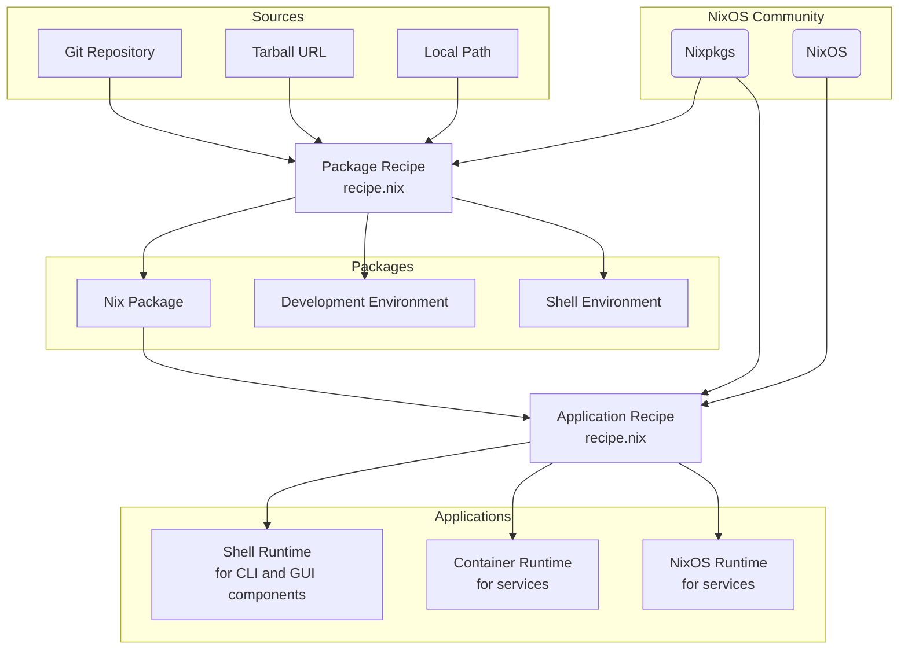

# NGI Forge

This software is in active development. Expect backwards incompatible changes.

## Features

- Simple, type checked configuration recipes for **packages** and
  **multi-component applications** using
  [module system](https://nix.dev/tutorials/module-system/index.html)

- [Web UI](https://ngi.nixos.org)

- Easy [self hosting](#self-hosting)

### Conceptual diagram



## Development

Launch local development environment

```bash
nix develop
```

and choose a command from the menu e.g, `forge-ui`.

Note that to save on download bandwidth and disk size, we support different types of shells depending on the required task:

- `minimal`: only required tools
- `ui`: minimal with local UI development tools
- `ci`: minimal with CI/CD tools and checks
- `default`: all tools

To activate one of those shells, run:

```bash
nix develop .#devShells.<system>.<shell-name>
```

## Self hosting

- Initiate new Nix Forge instance from template

```bash
nix flake init --template github:ngi-nix/forge#provider
```

- Set `repositoryUrl` attribute in `flake.nix` to your repository

- Add all new files to git

- Start creating recipes in `recipes` directory

## Nixpkgs repository

We package and maintain some NGI software in
[Nixpkgs](https://github.com/NixOS/nixpkgs) and re-use it in the Forge
application recipes.

Get a list of packages maintained in Nixpkgs

```bash
nix eval --json -f maintainers/list-nixpkgs.nix packages
```

[](https://github.com/ngi-nix/forge/actions/workflows/nixpkgs-build-status.yml)

## Credits

- This software was originally started as a fork of [imincik/nix-forge](https://github.com/imincik/nix-forge).
- Application hexagonal icons are adapted from the [NLnet Hex Gallery](https://nlnet.nl/gallery/hex.html), designed by the [NLnet Foundation](https://nlnet.nl/) and [Gust (@hex@lnrs.org)](https://social.lnrs.org/@hex) for NGI Zero-funded projects.
  Individual project logos and trademarks remain the property of their respective upstream projects.
